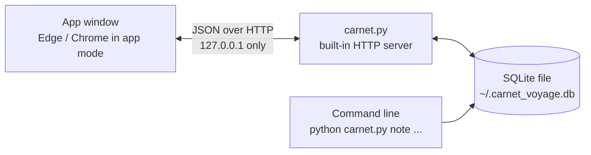
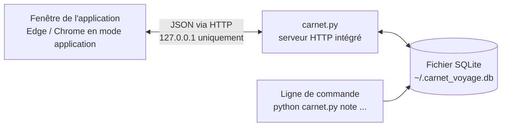

<a id="top"></a>

<div align="center">


<br>

**A beautiful, private travel journal that lives on your computer.**<br>
*Un carnet de voyage élégant et privé, qui vit sur votre ordinateur.*

<br>

No account · No cloud · No subscription · No dependencies<br>
*Pas de compte · Pas de cloud · Pas d'abonnement · Aucune dépendance*

<br>

[](https://www.python.org/downloads/)
[](#local-en)
[](#local-en)
[](#under-the-hood-en)
[](#install-en)
[](#status-en)

### [English](#english)  ·  [Français](#francais)

<br>


</div>

<br>

<a id="english"></a>

# English

<div align="center">

[Features](#features-en) · [How it works](#how-it-works-en) · [Install](#install-en) · [Exports](#exports-en) · [Local & private](#local-en) · [Command line](#cli-en) · [FAQ](#faq-en)

</div>

<br>

<a id="features-en"></a>

## ✨ Features

|   |   |
|---|---|
| 🧳 **Trips** | One *stamp* per trip in the sidebar, with country, dates, note count and total spent. |
| 🎫 **Days as tickets** | Every day is a perforated boarding-pass-style ticket: big date on the stub, your notes on the right. |
| 📝 **Rich notes** | Text, place (with autocomplete), mood from 1 to 5, amount spent, tags. Edit or delete any note — deletions can be undone. |
| 📷 **Photos** | Up to **3 photos per day**. Pick them, drag & drop them onto a day, or paste from the clipboard. Click to enlarge, use the arrow keys to browse. |
| 🔎 **Instant search** | Full-text, accent-insensitive, prefix matching: typing `ramén` finds *ramen*. Click any tag or place to filter. |
| 📊 **Insights** | A one-sentence summary of the trip, spending per day, most visited places, average mood. |
| 🌗 **Light, dark, auto** | Your theme, sort order and last opened trip are remembered. |
| 📤 **Exports** | Markdown, JSON, or a ZIP with the Markdown **and** your photos. |
| ⭐ **Highlights** | Star the moments you never want to lose. One click filters the journal down to them; they glow on the day tickets and in the calendar strip. |
| 💶 **Budget** | Set a budget per trip: a progress bar, what's left and your daily average appear in the header. |
| 🖼️ **Cover photo** | Make any trip photo its cover: it becomes the header background and the trip's stamp in the sidebar. |
| 🗓️ **Days at a glance** | A calendar strip shows every day of the trip — written, with photos, highlighted. Click a day to jump to it or to write it. |
| 🖨️ **Print / PDF** | One click for a clean, printable version of the journal, ready to save as a PDF. |
| 💾 **One-click backup** | A button downloads a complete copy of your journal: notes, photos and settings. |
| ⌨️ **Command line too** | Add a note in ten seconds without opening anything: `python carnet.py note Japan "Ramen in Kyoto"`. |
| 🔒 **Private by design** | Everything stays in one file on your disk. The app never talks to the internet. |

<br>

<a id="how-it-works-en"></a>

## 🧭 How it works

> The interface is currently in **French**. Button names are given below in *italics* with their English meaning.

**1 · Create a trip.** Click **New trip** (*Nouveau voyage*), give it a name, a country, optional dates and an optional budget. It appears in the sidebar as a small tilted postage stamp.

**2 · Write your day.** In the composer at the top of the trip, write what happened, then optionally add a place, a mood, an amount and tags. Amounts accept `12.5` or `12,5`. Tags are cleaned automatically (`#Food, Night` → `food`, `night`). Click the ☆ to make the note a highlight (*moment fort*). Press <kbd>Ctrl</kbd>+<kbd>Enter</kbd> to save.

**3 · Add photos.** Each day holds up to three. Use the dashed **Add a photo** tile on a day, drop images onto it, or paste one with <kbd>Ctrl</kbd>+<kbd>V</kbd> in the composer. You can even add photos to a day that has no note yet.

**4 · Look back.** The header summarizes the trip in a sentence (*"7 notes written in 4 places. €160.00 spent, average mood 4.4 out of 5. 6 photos."*). Below it: spending per day, most visited places, a calendar strip of the trip's days, then your days as tickets. Search from the bar, or press <kbd>/</kbd>.

**5 · Export or leave.** Download your journal in the format you like (see [Exports](#exports-en)), print it with **Imprimer / PDF**, back everything up with **Sauvegarder mes données**, or press **Quit** (*Quitter*). Closing the window also stops the app by itself a few seconds later.

<details>
<summary><b>Keyboard shortcuts</b></summary>

<br>

| Keys | Action |
|---|---|
| <kbd>/</kbd> or <kbd>Ctrl</kbd>/<kbd>⌘</kbd> + <kbd>K</kbd> | Focus the search bar |
| <kbd>Ctrl</kbd>/<kbd>⌘</kbd> + <kbd>Enter</kbd> | Save the note you're writing |
| <kbd>Esc</kbd> | Close a dialog or the photo viewer, or cancel an edit |
| <kbd>←</kbd> <kbd>→</kbd> | Previous / next photo in the viewer |
| <kbd>Ctrl</kbd> + <kbd>V</kbd> | Paste an image from the clipboard into the date selected in the composer |

</details>

<br>

<table>
<tr>
<td width="50%"><br><sub><b>Each day is a ticket</b> — notes, spending and up to three photos.</sub></td>
<td width="50%"><br><sub><b>Photo viewer</b> — arrows to browse, <kbd>Esc</kbd> to close.</sub></td>
</tr>
<tr>
<td width="50%"><br><sub><b>Dark theme</b> — automatic, or your choice.</sub></td>
<td width="50%" valign="top">

**Smart little details**

- Search ignores accents and matches word beginnings
- Click a tag or a place to filter on it
- Reverse the order (oldest first / newest first)
- Delete a note by mistake? Hit **Undo** (*Annuler*)
- Works on a narrow window too
- Amounts like `1 500,50` or `12 €` are understood
- A database from an older version of Carnet is upgraded automatically — nothing is lost

</td>
</tr>
</table>

<table>
<tr>
<td width="50%"><br><sub><b>Days at a glance</b> — a calendar strip, highlights, and a quick composer.</sub></td>
<td width="50%"><br><sub><b>Print / PDF</b> — a clean version of the journal, ready to save as a PDF.</sub></td>
</tr>
</table>

<br>

<a id="install-en"></a>

## 🚀 Install

Carnet is a **single Python file**. There is nothing to install except Python itself.

### Requirements

- **Python 3** (download it from [python.org](https://www.python.org/downloads/) — on Windows, tick **"Add Python to PATH"**).
- **Microsoft Edge, Google Chrome, Chromium or Brave** to get the clean app-window look. Edge is already on Windows 10/11. Without one of them, Carnet falls back to your default browser.
- No `pip install`, no virtual environment, no internet connection.

### Windows — double-click

1. Put `carnet.py` and `lancer.bat` in the same folder.
2. Double-click **`lancer.bat`**.
3. Press **`1`** for the app window, or **`2`** to use your browser.

### Any system — one command

```bash
python carnet.py          # opens the app window (default)
python carnet.py web      # same interface, in your browser (--port 8000, --no-browser)
```

> On macOS and Linux, use `python3` if `python` isn't available.

### Make a standalone `Carnet.exe` (Windows)

Want an app you can pin to the taskbar, on a PC without Python?

1. Keep `carnet.py` and `build_exe.bat` in the same folder.
2. Double-click **`build_exe.bat`**. It installs [PyInstaller](https://pyinstaller.org/) and builds the app (1–2 minutes).
3. Grab **`dist\Carnet.exe`**. Copy it anywhere. Drop a `carnet.ico` next to the script before building to give it an icon.

```bat
py -m PyInstaller --onefile --windowed --clean --noconfirm --name Carnet --exclude-module tkinter carnet.py
```

<sub>The executable is not code-signed, so Windows SmartScreen or your antivirus may warn on first launch — see the [FAQ](#faq-en). Prefer `--onedir` instead of `--onefile` for an instant start-up.</sub>

<br>

<a id="exports-en"></a>

## 📤 Exports

Your journal is never locked in. In the trip header you'll find the export buttons (*Exporter…*):

| Format | What you get | From the app | From the CLI |
|---|---|---|---|
| **Markdown** `.md` | A readable journal: one `##` section per day, notes with place and spending, ⭐ on highlights. Text only. | ✅ | ✅ `export` |
| **ZIP with photos** `.zip` | `trip.md` **+** a `photos/` folder. The Markdown embeds each image. Only appears once the trip has photos. | ✅ | — |
| **JSON** `.json` | Structured data (day, place, text, mood, amount, tags, highlight flag) for scripts, spreadsheets, or backups. Photos are not included. | ✅ | ✅ `export --format json` |

<details>
<summary><b>What the files look like</b></summary>

<br>

**Contents of the ZIP**

```text
Japon_2027.zip
├── Japon_2027.md
└── photos/
    ├── 2027-03-02_1.jpg
    ├── 2027-03-04_1.jpg
    ├── 2027-03-04_2.jpg
    └── 2027-03-04_3.jpg
```

**Markdown**

```markdown
# Japon 2027

## 2027-03-04


- ⭐ **Kyoto** — Fushimi Inari à l'aube, presque personne avant 7 h.
- **Kyoto** — Ramen à Gion, bouillon gras et nouilles parfaites. _(12.50 €)_
```

**JSON**

```json
{
  "voyage": "Japon 2027",
  "notes": [
    {
      "jour": "2027-03-04",
      "lieu": "Kyoto",
      "texte": "Ramen à Gion, bouillon gras et nouilles parfaites.",
      "humeur": 5,
      "depense": 12.5,
      "tags": "food,ramen",
      "favori": 0
    }
  ]
}
```

</details>

Photos in the ZIP are the full-size versions stored by Carnet (resized to at most 1600 px on the long edge), not your untouched originals — keep those somewhere safe too.

<br>

<a id="local-en"></a>

## 🏠 Everything runs locally

Carnet has no server "out there". When you launch it, it starts a tiny web server **inside your own computer** that only your computer can reach, and opens a window onto it.



| | |
|---|---|
| **Where is my data?** | One SQLite file: `~/.carnet_voyage.db` — on Windows `C:\Users\<you>\.carnet_voyage.db`. Notes, trips, settings **and photos** all live in it. |
| **Does it use the internet?** | No. The page loads no font, script, image or analytics from anywhere. It only talks to `127.0.0.1`. |
| **Who can reach the server?** | Only your machine: it listens on `127.0.0.1`, never on your network. |
| **How do I back it up?** | Click **Sauvegarder mes données** in the sidebar (or run `python carnet.py sauvegarde`): you get one `.db` file with everything — notes, photos, settings. You can also copy `~/.carnet_voyage.db` while Carnet is closed. |
| **How do I restore a backup?** | Close Carnet, then replace `~/.carnet_voyage.db` with your backup file (same name). Keep the old file somewhere until you've checked. |
| **How do I start over?** | Close Carnet and delete `~/.carnet_voyage.db`. |
| **Does it keep running in the background?** | No. Closing the window stops the app a few seconds later (a quick reload doesn't). You can also press **Quit**. |
| **Which port?** | `8765` for the app window (a free one is picked if it's busy), `8000` for `web`. Launching Carnet twice just opens a second window on the running instance. |

<details>
<summary><b>Security measures</b></summary>

<br>

The server is local-only, but it still defends itself, because any website you visit could try to poke at `localhost`:

- Listens on **`127.0.0.1` only**.
- Rejects requests whose **`Host`** header isn't `127.0.0.1:<port>` or `localhost:<port>` (protects against DNS rebinding).
- Rejects requests whose **`Origin`** differs from the page's own (protects against other sites sending requests).
- `POST` / `PUT` bodies must be **`application/json`**, which a foreign website cannot send without a permission check the server never grants.
- Uploaded photos must start with a real **JPEG signature** and stay under size limits (8 MB full, 800 KB thumbnail, 14 MB per request).
- Everything you type is **HTML-escaped** before display; pages and API responses carry `X-Content-Type-Options: nosniff` and `Cache-Control: no-store`.

</details>

<br>

<a id="under-the-hood-en"></a>

## ⚡ Under the hood

Built to stay fast with years of notes, using only Python's standard library.

- **SQLite in WAL mode** (`synchronous=NORMAL`) for quick, crash-safe writes.
- **Composite indexes** on `(trip, day)` for notes and photos: chronological reads stay instant.
- **FTS5 full-text search** with the `unicode61 remove_diacritics 2` tokenizer, kept in sync by triggers, with prefix matching.
- **Statistics in one SQL pass** (counts, totals, mood average, spending per day, top places, highlights).
- **Safe upgrades**: at start-up, columns added by newer versions are created on older databases (`ALTER TABLE`), so an existing journal opens without any manual step.
- **Consistent backups** use SQLite's own backup API, even while the app is running.
- **A real print layout**: a dedicated `@media print` stylesheet forces a light theme, drops the interface chrome and keeps each day ticket on one page.
- **Photos are resized in your browser** before upload (full ≤ 1600 px at quality 85, thumbnail ≤ 480 px at quality 80), orientation-corrected, then stored as BLOBs. Thumbnails load lazily, and images are served with an `immutable` cache header since a photo never changes.
- **Threaded server + one lock** around the database, so a slow request never blocks the window.
- **Zero build step**: the interface is a single HTML/CSS/JS page embedded in `carnet.py`. No framework, no bundler.

<details>
<summary><b>Data model</b></summary>

<br>

| Table | Purpose |
|---|---|
| `voyage` | `id`, `nom` (unique, case-insensitive), `pays`, `debut`, `fin`, `budget`, `couverture` (id of a photo) |
| `note` | `id`, `voyage_id` → `voyage` (cascade), `jour`, `lieu`, `texte`, `humeur` (1–5), `depense`, `tags`, `favori` (0/1) |
| `photo` | `id`, `voyage_id` → `voyage` (cascade), `jour`, `grande` (BLOB), `mini` (BLOB) — max 3 per trip and day |
| `reglage` | key/value settings: theme, sort order, last opened trip |
| `note_fts` | FTS5 index over `lieu`, `texte`, `tags`, maintained by insert/update/delete triggers |

Deleting a trip deletes its notes and photos in one go.

</details>

<details>
<summary><b>Local HTTP API</b></summary>

<br>

The window talks to the server through a small JSON API (handy if you want to script against it while Carnet is running).

| Method | Path | Purpose |
|---|---|---|
| `GET` | `/api/voyages` | List trips with note count and total spent |
| `POST` | `/api/voyage` | Create a trip |
| `GET` `PUT` `DELETE` | `/api/voyage/<id>` | Read (notes, stats, photos; `?q=` to search), update, delete a trip |
| `PUT` | `/api/voyage/<id>/couverture` | Set (`photo_id`) or clear (`null`) the cover photo |
| `GET` | `/api/voyage/<id>/export?format=md\|json\|zip` | Download an export |
| `POST` | `/api/note` | Add a note |
| `PUT` `DELETE` | `/api/note/<id>` | Edit or delete a note |
| `PUT` | `/api/note/<id>/favori` | Mark or unmark a highlight |
| `POST` | `/api/photo` | Add a photo (`voyage_id`, `jour`, base64 `grande` and `mini`) |
| `GET` `DELETE` | `/api/photo/<id>` | Fetch (`?v=mini` for the thumbnail) or delete a photo |
| `GET` `PUT` | `/api/reglages`, `/api/reglage` | Read / write settings |
| `GET` | `/api/sauvegarde` | Download a consistent copy of the whole database |
| `GET` `POST` | `/api/ping`, `/api/bye`, `/api/quit` | Window heartbeat, window closed, quit |

</details>

<br>

<a id="cli-en"></a>

## ⌨️ Command line

The terminal commands share the same database as the app. Their messages are in French.

```bash
python carnet.py voyage "Japon 2027" --pays Japon --debut 2027-03-01 --fin 2027-03-15
python carnet.py note "Japon 2027" "Ramen à Kyoto" --lieu Kyoto --humeur 5 --depense 12,5 --tags food,ramen
python carnet.py lire "Japon 2027"
python carnet.py chercher ramén
python carnet.py stats "Japon 2027"
python carnet.py export "Japon 2027" -o japon.md        # or --format json
python carnet.py voyage "Japon 2027" --budget "2 000"
python carnet.py note "Japon 2027" "Fushimi Inari à l'aube" --lieu Kyoto --favori
python carnet.py sauvegarde -o mon-carnet.db
```

<details>
<summary><b>All commands</b></summary>

<br>

| Command | Purpose | Options |
|---|---|---|
| *(none)* / `gui` | Open the app window | |
| `web` | Open the interface in your browser | `--port`, `--no-browser` |
| `voyage <name>` | Create or update a trip | `--pays`, `--debut`, `--fin` (dates `YYYY-MM-DD`), `--budget` |
| `voyages` | List trips with totals | |
| `note <trip> <text>` | Add a note | `--lieu`, `--jour`, `--humeur 1-5`, `--depense`, `--tags`, `--favori` |
| `lire <trip>` | Read a trip's notes | `--limite` |
| `chercher <query>` | Full-text search | `--limite` |
| `stats [trip]` | Statistics | |
| `suppr <id>` | Delete a note by ID | |
| `export <trip>` | Export to Markdown or JSON | `--format md\|json`, `-o file` |
| `sauvegarde` | Save a full copy of the journal (notes, photos, settings) | `-o file.db` |

Photos are added from the app (the ZIP export is app-only too).

</details>

<br>

<a id="faq-en"></a>

## 🧰 FAQ

<details>
<summary><b>"python is not recognized as a command" (Windows)</b></summary>

<br>

Install Python from [python.org](https://www.python.org/downloads/) and tick **"Add Python to PATH"**. `lancer.bat` also tries the `py` launcher automatically.

</details>

<details>
<summary><b>The app opens in my normal browser instead of its own window</b></summary>

<br>

Carnet looks for Edge, Chrome, Chromium or Brave to open a chrome-less window. If none is found it uses your default browser — everything works, you just see a tab. Use the **Quit** button to stop it.

</details>

<details>
<summary><b>Windows or my antivirus warns about <code>Carnet.exe</code></b></summary>

<br>

The executable isn't code-signed, and single-file PyInstaller programs are often flagged by cautious scanners. You can click **More info → Run anyway**, or skip the `.exe` entirely and run `python carnet.py` — it's one readable file you can inspect yourself.

</details>

<details>
<summary><b>My iPhone photos (HEIC) are refused</b></summary>

<br>

Photos are decoded by your browser, which must understand the format. JPEG, PNG, WebP and similar work everywhere. For HEIC, install Microsoft's *HEIF Image Extensions* on Windows, or export the pictures as JPEG first.

</details>

<details>
<summary><b>How do I save a trip as a PDF?</b></summary>

<br>

Click **Imprimer / PDF** in the trip header, pick **Save as PDF** as the destination and tick **Background graphics** so the header and the airmail stripe keep their colours. The print layout is always light, even if you use the dark theme.

</details>

<details>
<summary><b>Can I use Carnet on two computers?</b></summary>

<br>

There's no sync. You can copy `~/.carnet_voyage.db` from one machine to another while Carnet is closed. Avoid keeping the live file in a cloud-synced folder, and never open the same file on two machines at once — SQLite databases don't like that.

</details>

<br>

<a id="status-en"></a>

## 📌 Status & limits

- **Interface language: French only** for now (CLI messages too). An English interface is a natural next step.
- Built and tested with **Python 3.12** and a Chromium engine. Windows 10/11 with Edge is the primary target; macOS and Linux should work through the same Chromium-based window or `web` mode.
- Single user, single computer, no sync.
- **3 photos per day** by design, to keep the journal light and the days easy to scan.
- Ideas, not promises: English interface, map of visited places, one-click restore, spending breakdown by tag.

<br>

## 🗂️ What's in the box

```text
carnet/
├── carnet.py            the entire app: storage + CLI + local server + interface
├── lancer.bat           Windows launcher (window or browser)
├── build_exe.bat        builds dist\Carnet.exe with PyInstaller
├── README.md            you are here (English + Français)
├── assets/banner.svg
└── docs/screenshots/
```

<p align="right"><a href="#top">↑ Top</a> · <a href="#francais">Passer en français →</a></p>

---

<a id="francais"></a>

# Français

<div align="center">

[Fonctionnalités](#features-fr) · [Fonctionnement](#how-it-works-fr) · [Installation](#install-fr) · [Exports](#exports-fr) · [Local et privé](#local-fr) · [Ligne de commande](#cli-fr) · [FAQ](#faq-fr)

</div>

<br>

<a id="features-fr"></a>

## ✨ Fonctionnalités

|   |   |
|---|---|
| 🧳 **Voyages** | Un *timbre* par voyage dans la barre latérale, avec le pays, le nombre de notes et le total dépensé. |
| 🎫 **Des journées en billets** | Chaque jour est un billet perforé façon carte d'embarquement : la date en grand sur le talon, vos notes à droite. |
| 📝 **Des notes complètes** | Texte, lieu (avec saisie assistée), humeur de 1 à 5, montant dépensé, tags. Chaque note se modifie ou se supprime, et une suppression s'annule. |
| 📷 **Photos** | Jusqu'à **3 photos par jour**. Choisies dans vos dossiers, glissées sur un jour ou collées depuis le presse-papiers. Un clic pour agrandir, les flèches du clavier pour naviguer. |
| 🔎 **Recherche instantanée** | Plein texte, insensible aux accents, par début de mot : taper `ramén` retrouve *ramen*. Un clic sur un tag ou un lieu filtre aussitôt. |
| 📊 **Aperçu** | Un résumé du voyage en une phrase, les dépenses par jour, les lieux les plus visités, l'humeur moyenne. |
| 🌗 **Clair, sombre, auto** | Le thème, l'ordre d'affichage et le dernier voyage ouvert sont mémorisés. |
| 📤 **Exports** | Markdown, JSON, ou un ZIP contenant le Markdown **et** les photos. |
| ⭐ **Moments forts** | Une étoile sur les instants à ne jamais perdre. Un clic filtre le carnet sur eux ; ils brillent sur les billets et dans la frise des jours. |
| 💶 **Budget** | Un budget par voyage : barre de progression, reste à dépenser et moyenne par jour dans l'en-tête. |
| 🖼️ **Photo de couverture** | N'importe quelle photo du voyage devient sa couverture : fond de l'en-tête et timbre du voyage dans la barre latérale. |
| 🗓️ **Les jours d'un coup d'œil** | Une frise montre chaque jour du voyage : écrit, avec photos, moment fort. Un clic va au jour ou prépare sa saisie. |
| 🖨️ **Impression / PDF** | Un clic pour une version imprimable soignée du carnet, enregistrable en PDF. |
| 💾 **Sauvegarde en un clic** | Un bouton télécharge une copie complète du carnet : notes, photos et réglages. |
| ⌨️ **Aussi en ligne de commande** | Ajouter une note en dix secondes sans rien ouvrir : `python carnet.py note Japon "Ramen à Kyoto"`. |
| 🔒 **Privé par conception** | Tout reste dans un seul fichier sur votre disque. L'application ne communique jamais avec Internet. |

<br>

<a id="how-it-works-fr"></a>

## 🧭 Fonctionnement

**1 · Créer un voyage.** Cliquer sur **Nouveau voyage**, choisir un nom, un pays et, si l'on veut, des dates, voire un budget. Le voyage apparaît dans la barre latérale sous la forme d'un petit timbre légèrement penché.

**2 · Écrire sa journée.** Dans la zone de saisie en haut du voyage, raconter ce qui s'est passé, puis ajouter si besoin un lieu, une humeur, un montant et des tags. Les montants acceptent `12.5` comme `12,5`. Les tags sont nettoyés automatiquement (`#Food, Nuit` devient `food`, `nuit`). Un clic sur ☆ fait de la note un moment fort. <kbd>Ctrl</kbd>+<kbd>Entrée</kbd> enregistre la note.

**3 · Ajouter des photos.** Chaque jour en accepte trois. Utiliser la tuile en pointillés **Ajouter une photo**, déposer des images sur le billet, ou coller une image avec <kbd>Ctrl</kbd>+<kbd>V</kbd> dans la zone de saisie. Il est même possible d'ajouter des photos à un jour qui n'a pas encore de note.

**4 · Revivre le voyage.** L'en-tête résume tout en une phrase (*« 7 notes écrites dans 4 lieux. 160,00 € dépensés, humeur moyenne de 4,4 sur 5. 6 photos. »*). En dessous : les dépenses par jour, les lieux les plus visités, une frise des jours du voyage, puis les journées sous forme de billets. La recherche se trouve dans la barre dédiée, ou s'ouvre avec <kbd>/</kbd>.

**5 · Exporter ou quitter.** Télécharger le carnet au format de son choix (voir [Exports](#exports-fr)), l'imprimer avec **Imprimer / PDF**, tout sauvegarder avec **Sauvegarder mes données**, ou cliquer sur **Quitter**. Fermer la fenêtre arrête aussi l'application toute seule quelques secondes plus tard.

<details>
<summary><b>Raccourcis clavier</b></summary>

<br>

| Touches | Action |
|---|---|
| <kbd>/</kbd> ou <kbd>Ctrl</kbd>/<kbd>⌘</kbd> + <kbd>K</kbd> | Placer le curseur dans la recherche |
| <kbd>Ctrl</kbd>/<kbd>⌘</kbd> + <kbd>Entrée</kbd> | Enregistrer la note en cours |
| <kbd>Échap</kbd> | Fermer une fenêtre ou le visualiseur de photos, ou annuler une modification |
| <kbd>←</kbd> <kbd>→</kbd> | Photo précédente / suivante dans le visualiseur |
| <kbd>Ctrl</kbd> + <kbd>V</kbd> | Coller une image du presse-papiers à la date choisie dans la zone de saisie |

</details>

<br>

<table>
<tr>
<td width="50%"><br><sub><b>Chaque jour est un billet</b> : notes, dépenses et jusqu'à trois photos.</sub></td>
<td width="50%"><br><sub><b>Visualiseur de photos</b> : flèches pour naviguer, <kbd>Échap</kbd> pour fermer.</sub></td>
</tr>
<tr>
<td width="50%"><br><sub><b>Thème sombre</b> : automatique, ou selon votre choix.</sub></td>
<td width="50%" valign="top">

**Petits détails utiles**

- La recherche ignore les accents et reconnaît les débuts de mots
- Un clic sur un tag ou un lieu filtre les notes
- Ordre inversable (du plus ancien au plus récent, ou l'inverse)
- Une note supprimée par erreur ? Un clic sur **Annuler**
- S'adapte aussi aux fenêtres étroites
- Les montants comme `1 500,50` ou `12 €` sont compris
- Une base créée par une ancienne version de Carnet est mise à niveau automatiquement, sans rien perdre

</td>
</tr>
</table>

<table>
<tr>
<td width="50%"><br><sub><b>Les jours d'un coup d'œil</b> : frise, moments forts et saisie rapide.</sub></td>
<td width="50%"><br><sub><b>Impression / PDF</b> : une version soignée du carnet, à enregistrer en PDF.</sub></td>
</tr>
</table>

<br>

<a id="install-fr"></a>

## 🚀 Installation

Carnet tient dans **un seul fichier Python**. Il n'y a rien à installer, à part Python lui-même.

### Prérequis

- **Python 3** (à télécharger sur [python.org](https://www.python.org/downloads/) ; sous Windows, cocher **« Add Python to PATH »**).
- **Microsoft Edge, Google Chrome, Chromium ou Brave** pour obtenir la fenêtre d'application épurée. Edge est déjà présent sur Windows 10/11. À défaut, Carnet s'ouvre dans le navigateur par défaut.
- Pas de `pip install`, pas d'environnement virtuel, pas de connexion Internet.

### Windows : un double-clic

1. Placer `carnet.py` et `lancer.bat` dans le même dossier.
2. Double-cliquer sur **`lancer.bat`**.
3. Taper **`1`** pour la fenêtre d'application, ou **`2`** pour utiliser le navigateur.

### Tous systèmes : une commande

```bash
python carnet.py          # ouvre la fenêtre d'application (par défaut)
python carnet.py web      # même interface, dans le navigateur (--port 8000, --no-browser)
```

> Sous macOS et Linux, utiliser `python3` si `python` n'existe pas.

### Créer un `Carnet.exe` autonome (Windows)

Une vraie application à épingler dans la barre des tâches, utilisable sur un PC sans Python ?

1. Garder `carnet.py` et `build_exe.bat` dans le même dossier.
2. Double-cliquer sur **`build_exe.bat`**. Il installe [PyInstaller](https://pyinstaller.org/) puis construit l'application (1 à 2 minutes).
3. Récupérer **`dist\Carnet.exe`**, qui peut être copié n'importe où. Un fichier `carnet.ico` placé à côté du script avant la construction sert d'icône.

```bat
py -m PyInstaller --onefile --windowed --clean --noconfirm --name Carnet --exclude-module tkinter carnet.py
```

<sub>L'exécutable n'est pas signé : Windows SmartScreen ou l'antivirus peuvent afficher un avertissement au premier lancement (voir la [FAQ](#faq-fr)). Remplacer `--onefile` par `--onedir` donne un démarrage instantané.</sub>

<br>

<a id="exports-fr"></a>

## 📤 Exports

Le carnet n'est jamais enfermé. Les boutons d'export (*Exporter…*) se trouvent dans l'en-tête de chaque voyage :

| Format | Contenu | Depuis l'application | En ligne de commande |
|---|---|---|---|
| **Markdown** `.md` | Un journal lisible : une section `##` par jour, les notes avec lieu et dépense, ⭐ sur les moments forts. Texte seul. | ✅ | ✅ `export` |
| **ZIP avec photos** `.zip` | `voyage.md` **+** un dossier `photos/`. Le Markdown intègre chaque image. N'apparaît que lorsque le voyage contient des photos. | ✅ | — |
| **JSON** `.json` | Données structurées (jour, lieu, texte, humeur, montant, tags, moment fort) pour des scripts, un tableur ou une sauvegarde. Sans les photos. | ✅ | ✅ `export --format json` |

<details>
<summary><b>À quoi ressemblent les fichiers</b></summary>

<br>

**Contenu du ZIP**

```text
Japon_2027.zip
├── Japon_2027.md
└── photos/
    ├── 2027-03-02_1.jpg
    ├── 2027-03-04_1.jpg
    ├── 2027-03-04_2.jpg
    └── 2027-03-04_3.jpg
```

**Markdown**

```markdown
# Japon 2027

## 2027-03-04


- ⭐ **Kyoto** — Fushimi Inari à l'aube, presque personne avant 7 h.
- **Kyoto** — Ramen à Gion, bouillon gras et nouilles parfaites. _(12.50 €)_
```

**JSON**

```json
{
  "voyage": "Japon 2027",
  "notes": [
    {
      "jour": "2027-03-04",
      "lieu": "Kyoto",
      "texte": "Ramen à Gion, bouillon gras et nouilles parfaites.",
      "humeur": 5,
      "depense": 12.5,
      "tags": "food,ramen",
      "favori": 0
    }
  ]
}
```

</details>

Les photos du ZIP sont les versions enregistrées par Carnet (réduites à 1600 px maximum sur le grand côté), pas vos originaux : il faut donc aussi conserver ces derniers ailleurs.

<br>

<a id="local-fr"></a>

## 🏠 Tout tourne en local

Carnet n'a aucun serveur « quelque part sur Internet ». Au lancement, il démarre un minuscule serveur web **à l'intérieur de votre propre ordinateur**, joignable uniquement depuis celui-ci, et ouvre une fenêtre dessus.



| | |
|---|---|
| **Où sont mes données ?** | Dans un seul fichier SQLite : `~/.carnet_voyage.db`, soit sous Windows `C:\Users\<vous>\.carnet_voyage.db`. Notes, voyages, réglages **et photos** y sont tous stockés. |
| **Internet est-il utilisé ?** | Non. La page ne charge aucune police, aucun script, aucune image ni aucun outil de statistiques depuis l'extérieur. Elle ne parle qu'à `127.0.0.1`. |
| **Qui peut joindre le serveur ?** | Uniquement votre machine : il écoute sur `127.0.0.1` et jamais sur le réseau. |
| **Comment sauvegarder ?** | Cliquer sur **Sauvegarder mes données** dans la barre latérale (ou lancer `python carnet.py sauvegarde`) : un seul fichier `.db` contient tout — notes, photos, réglages. Il est aussi possible de copier `~/.carnet_voyage.db` quand Carnet est fermé. |
| **Comment restaurer une sauvegarde ?** | Fermer Carnet, puis remplacer `~/.carnet_voyage.db` par le fichier de sauvegarde (même nom). Garder l'ancien fichier de côté le temps de vérifier. |
| **Comment repartir de zéro ?** | Fermer Carnet et supprimer `~/.carnet_voyage.db`. |
| **Reste-t-il actif en arrière-plan ?** | Non. Fermer la fenêtre arrête l'application quelques secondes plus tard (un simple rechargement ne l'arrête pas). Le bouton **Quitter** fait la même chose immédiatement. |
| **Quel port ?** | `8765` pour la fenêtre d'application (un port libre est choisi s'il est occupé), `8000` pour `web`. Lancer Carnet deux fois ouvre simplement une seconde fenêtre sur l'instance déjà active. |

<details>
<summary><b>Mesures de sécurité</b></summary>

<br>

Le serveur est strictement local, mais il se protège quand même : n'importe quel site visité pourrait tenter de contacter `localhost`.

- Écoute **uniquement sur `127.0.0.1`**.
- Refuse les requêtes dont l'en-tête **`Host`** n'est pas `127.0.0.1:<port>` ou `localhost:<port>` (protection contre le DNS rebinding).
- Refuse les requêtes dont l'**`Origin`** diffère de celle de la page (protection contre les requêtes envoyées par d'autres sites).
- Les corps de requêtes `POST` / `PUT` doivent être en **`application/json`**, ce qu'un site tiers ne peut pas envoyer sans une autorisation que le serveur n'accorde jamais.
- Les photos envoyées doivent commencer par une vraie **signature JPEG** et respecter des limites de taille (8 Mo en version complète, 800 Ko en miniature, 14 Mo par requête).
- Tout ce qui est saisi est **échappé en HTML** avant d'être affiché ; les pages et réponses de l'API portent `X-Content-Type-Options: nosniff` et `Cache-Control: no-store`.

</details>

<br>

<a id="under-the-hood-fr"></a>

## ⚡ Sous le capot

Conçu pour rester rapide avec des années de notes, en n'utilisant que la bibliothèque standard de Python.

- **SQLite en mode WAL** (`synchronous=NORMAL`) pour des écritures rapides et résistantes aux plantages.
- **Index composites** sur `(voyage, jour)` pour les notes et les photos : la lecture chronologique reste instantanée.
- **Recherche plein texte FTS5** avec le tokenizer `unicode61 remove_diacritics 2`, synchronisée par des déclencheurs, avec correspondance par préfixe.
- **Statistiques en une seule passe SQL** (comptes, totaux, humeur moyenne, dépenses par jour, lieux principaux, moments forts).
- **Mises à niveau sans risque** : au démarrage, les colonnes ajoutées par les versions récentes sont créées dans les anciennes bases (`ALTER TABLE`) : un carnet existant s'ouvre sans aucune manipulation.
- **Sauvegardes cohérentes** grâce à l'API de sauvegarde de SQLite, même pendant que l'application tourne.
- **Une vraie mise en page d'impression** : une feuille de style `@media print` impose un thème clair, retire les éléments d'interface et garde chaque billet sur une seule page.
- **Photos réduites dans le navigateur** avant l'envoi (version complète ≤ 1600 px en qualité 85, miniature ≤ 480 px en qualité 80), orientation corrigée, puis stockées en BLOB. Les miniatures se chargent à la demande et les images sont servies avec un cache `immutable`, puisqu'une photo ne change jamais.
- **Serveur multi-threads + un verrou** autour de la base : une requête lente ne bloque jamais la fenêtre.
- **Aucune étape de build** : l'interface est une page HTML/CSS/JS unique, intégrée dans `carnet.py`. Ni framework ni bundler.

<details>
<summary><b>Modèle de données</b></summary>

<br>

| Table | Rôle |
|---|---|
| `voyage` | `id`, `nom` (unique, insensible à la casse), `pays`, `debut`, `fin`, `budget`, `couverture` (id d'une photo) |
| `note` | `id`, `voyage_id` → `voyage` (suppression en cascade), `jour`, `lieu`, `texte`, `humeur` (1–5), `depense`, `tags`, `favori` (0/1) |
| `photo` | `id`, `voyage_id` → `voyage` (cascade), `jour`, `grande` (BLOB), `mini` (BLOB) — 3 maximum par voyage et par jour |
| `reglage` | réglages clé/valeur : thème, ordre d'affichage, dernier voyage ouvert |
| `note_fts` | index FTS5 sur `lieu`, `texte`, `tags`, tenu à jour par des déclencheurs d'insertion, de modification et de suppression |

Supprimer un voyage supprime d'un coup ses notes et ses photos.

</details>

<details>
<summary><b>API HTTP locale</b></summary>

<br>

La fenêtre dialogue avec le serveur au moyen d'une petite API JSON (pratique pour écrire des scripts pendant que Carnet tourne).

| Méthode | Chemin | Rôle |
|---|---|---|
| `GET` | `/api/voyages` | Lister les voyages avec nombre de notes et total dépensé |
| `POST` | `/api/voyage` | Créer un voyage |
| `GET` `PUT` `DELETE` | `/api/voyage/<id>` | Lire (notes, statistiques, photos ; `?q=` pour chercher), modifier, supprimer un voyage |
| `PUT` | `/api/voyage/<id>/couverture` | Définir (`photo_id`) ou retirer (`null`) la photo de couverture |
| `GET` | `/api/voyage/<id>/export?format=md\|json\|zip` | Télécharger un export |
| `POST` | `/api/note` | Ajouter une note |
| `PUT` `DELETE` | `/api/note/<id>` | Modifier ou supprimer une note |
| `PUT` | `/api/note/<id>/favori` | Marquer ou retirer un moment fort |
| `POST` | `/api/photo` | Ajouter une photo (`voyage_id`, `jour`, `grande` et `mini` en base64) |
| `GET` `DELETE` | `/api/photo/<id>` | Récupérer (`?v=mini` pour la miniature) ou supprimer une photo |
| `GET` `PUT` | `/api/reglages`, `/api/reglage` | Lire / écrire les réglages |
| `GET` | `/api/sauvegarde` | Télécharger une copie cohérente de toute la base |
| `GET` `POST` | `/api/ping`, `/api/bye`, `/api/quit` | Signal de vie de la fenêtre, fenêtre fermée, quitter |

</details>

<br>

<a id="cli-fr"></a>

## ⌨️ Ligne de commande

Les commandes du terminal partagent la même base de données que l'application.

```bash
python carnet.py voyage "Japon 2027" --pays Japon --debut 2027-03-01 --fin 2027-03-15
python carnet.py note "Japon 2027" "Ramen à Kyoto" --lieu Kyoto --humeur 5 --depense 12,5 --tags food,ramen
python carnet.py lire "Japon 2027"
python carnet.py chercher ramén
python carnet.py stats "Japon 2027"
python carnet.py export "Japon 2027" -o japon.md        # ou --format json
python carnet.py voyage "Japon 2027" --budget "2 000"
python carnet.py note "Japon 2027" "Fushimi Inari à l'aube" --lieu Kyoto --favori
python carnet.py sauvegarde -o mon-carnet.db
```

<details>
<summary><b>Toutes les commandes</b></summary>

<br>

| Commande | Rôle | Options |
|---|---|---|
| *(aucune)* / `gui` | Ouvrir la fenêtre d'application | |
| `web` | Ouvrir l'interface dans le navigateur | `--port`, `--no-browser` |
| `voyage <nom>` | Créer ou mettre à jour un voyage | `--pays`, `--debut`, `--fin` (dates `AAAA-MM-JJ`), `--budget` |
| `voyages` | Lister les voyages et leurs totaux | |
| `note <voyage> <texte>` | Ajouter une note | `--lieu`, `--jour`, `--humeur 1-5`, `--depense`, `--tags`, `--favori` |
| `lire <voyage>` | Lire les notes d'un voyage | `--limite` |
| `chercher <requête>` | Recherche plein texte | `--limite` |
| `stats [voyage]` | Statistiques | |
| `suppr <id>` | Supprimer une note par son identifiant | |
| `export <voyage>` | Exporter en Markdown ou JSON | `--format md\|json`, `-o fichier` |
| `sauvegarde` | Copier tout le carnet (notes, photos, réglages) | `-o fichier.db` |

Les photos s'ajoutent depuis l'application (l'export ZIP aussi n'est disponible que là).

</details>

<br>

<a id="faq-fr"></a>

## 🧰 FAQ

<details>
<summary><b>« python n'est pas reconnu en tant que commande » (Windows)</b></summary>

<br>

Installer Python depuis [python.org](https://www.python.org/downloads/) en cochant **« Add Python to PATH »**. `lancer.bat` essaie aussi automatiquement le lanceur `py`.

</details>

<details>
<summary><b>L'application s'ouvre dans mon navigateur habituel au lieu de sa propre fenêtre</b></summary>

<br>

Carnet cherche Edge, Chrome, Chromium ou Brave pour ouvrir une fenêtre sans barre d'adresse. S'il n'en trouve aucun, il utilise le navigateur par défaut : tout fonctionne, on voit simplement un onglet. Le bouton **Quitter** arrête l'application.

</details>

<details>
<summary><b>Windows ou mon antivirus signale <code>Carnet.exe</code></b></summary>

<br>

L'exécutable n'est pas signé, et les programmes PyInstaller en fichier unique sont souvent signalés par les analyseurs prudents. Il est possible de cliquer sur **Informations complémentaires → Exécuter quand même**, ou de se passer de l'`.exe` et de lancer `python carnet.py` : c'est un seul fichier lisible, que l'on peut inspecter soi-même.

</details>

<details>
<summary><b>Mes photos d'iPhone (HEIC) sont refusées</b></summary>

<br>

Les photos sont décodées par le navigateur, qui doit comprendre le format. JPEG, PNG, WebP et formats similaires fonctionnent partout. Pour le HEIC, installer sous Windows l'extension Microsoft *Extensions d'image HEIF*, ou exporter d'abord les images en JPEG.

</details>

<details>
<summary><b>Comment enregistrer un voyage en PDF ?</b></summary>

<br>

Cliquer sur **Imprimer / PDF** dans l'en-tête du voyage, choisir **Enregistrer au format PDF** comme destination et cocher **Graphiques d'arrière-plan** pour que l'en-tête et le liseré courrier aérien gardent leurs couleurs. La mise en page d'impression est toujours claire, même avec le thème sombre.

</details>

<details>
<summary><b>Puis-je utiliser Carnet sur deux ordinateurs ?</b></summary>

<br>

Il n'y a pas de synchronisation. Le fichier `~/.carnet_voyage.db` peut être copié d'une machine à l'autre pendant que Carnet est fermé. Éviter de laisser le fichier en cours d'utilisation dans un dossier synchronisé par un service cloud, et ne jamais ouvrir le même fichier sur deux machines à la fois : les bases SQLite n'aiment pas cela.

</details>

<br>

<a id="status-fr"></a>

## 📌 État et limites

- **Interface en français uniquement** pour le moment (messages de la ligne de commande compris). Une interface en anglais est une suite naturelle.
- Développé et testé avec **Python 3.12** et un moteur Chromium. Windows 10/11 avec Edge est la cible principale ; macOS et Linux devraient fonctionner avec la même fenêtre basée sur Chromium, ou avec le mode `web`.
- Un seul utilisateur, un seul ordinateur, pas de synchronisation.
- **3 photos par jour**, volontairement, pour garder un carnet léger et des journées faciles à parcourir.
- Des idées, pas des promesses : interface en anglais, carte des lieux visités, restauration en un clic, dépenses par tag.

<br>

## 🗂️ Contenu du dépôt

```text
carnet/
├── carnet.py            toute l'application : stockage + CLI + serveur local + interface
├── lancer.bat           lanceur Windows (fenêtre ou navigateur)
├── build_exe.bat        construit dist\Carnet.exe avec PyInstaller
├── README.md            vous êtes ici (English + Français)
├── assets/banner.svg
└── docs/screenshots/
```

<p align="right"><a href="#top">↑ Haut de page</a> · <a href="#english">Switch to English →</a></p>

<div align="center">

<br>

*Made for people who like their memories close to home.*<br>
*Pour ceux qui gardent leurs souvenirs près de chez eux.*


</div>
